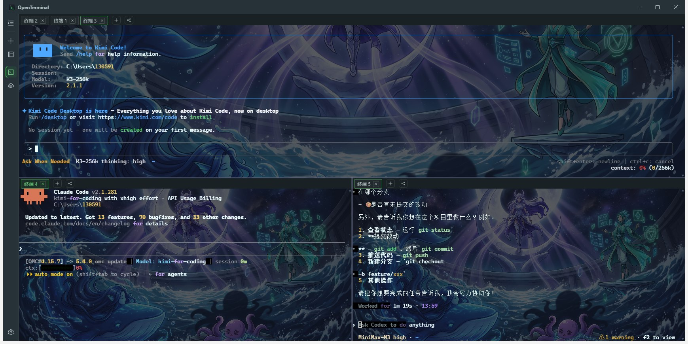
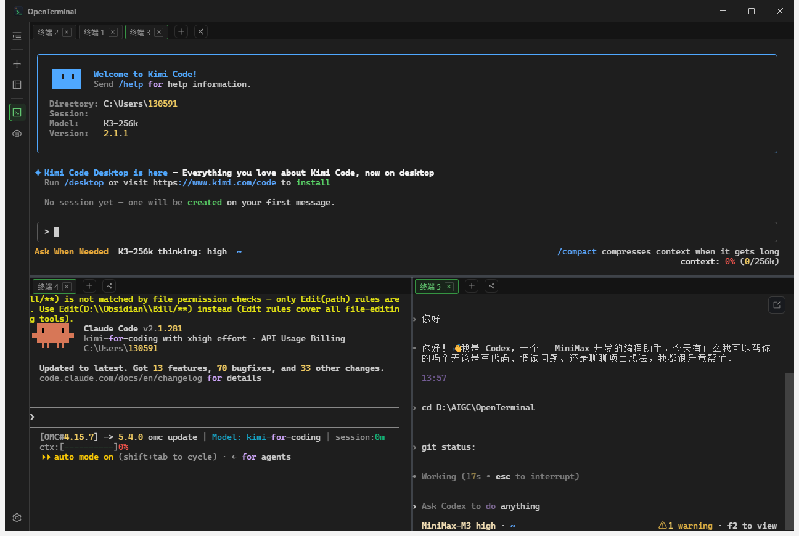
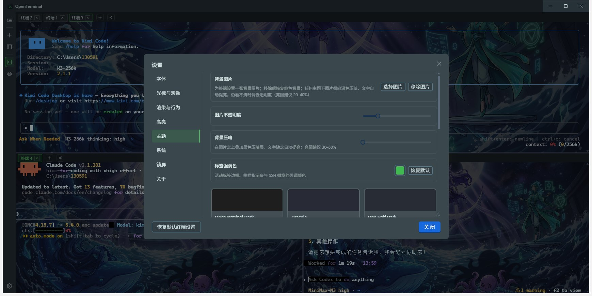
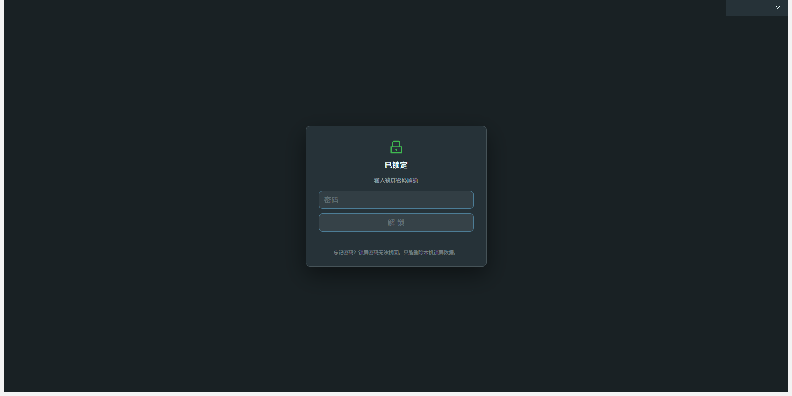

# OpenTerminal

[简体中文](README.md) | **English**

A modern, open-source terminal app: local terminal + SSH remote sessions + split-pane management + theme/font customization. Built with Electron + React + TypeScript, developed from scratch.

> Product website (GitHub Pages): <https://billowliu2.github.io/OpenTerminal/>, source in [`website/`](website/).

## Screenshots

| Multi-split parallel AI coding agents | Clean split view without background image |
| --- | --- |
|  |  |

| Themes & personalization (background image / opacity / dim layer) | Lock screen (Ctrl+L, sessions stay alive under the mask) |
| --- | --- |
|  |  |

## Highlights

- **Lightweight**: renderer dependencies are fully bundled and never duplicated into the installer — the app's asar is only 8.1MB, NSIS installer about 109MB; single-exe installer with in-app auto-update
- **Privacy & security**: SSH credentials encrypted at rest via DPAPI, the renderer never touches plaintext; the lock-screen password stores only a scrypt-derived value; local paths for SFTP/ZMODEM must be granted through system dialogs, blocking constructed-path reads/writes
- **Performance**: xterm.js WebGL rendering; keyword highlight engine measured at 0.02–0.05ms/KB (4–9ms for 200KB of mixed output); virtualized scrolling for large SFTP directories; debounced split-pane resizing so TUIs don't redraw repeatedly
- **AI-coding friendly**: optimized for high-frequency TUIs like Kimi Code / Claude Code / Codex; IME candidate window follows the cursor for Chinese input
- **Works in China**: update checks try GitHub first (following the system proxy), then automatically fall back to a direct-connect domestic channel, with a 30s overall timeout when both are unreachable
- **Open & auditable**: MIT license; contracts for main/preload/renderer live in `src/shared/`, zero cross-module coupling; 36 offline tests covering storage, lock screen, highlighting, transfers and update fallback

## Quick Start

```bash
npm install        # skip if already installed
npm run dev        # development mode (hot reload)
npm run build      # production build to out/
npm run typecheck  # full type checking
npm test           # runs typecheck first, then rebuilds test bundles and runs 36 offline tests (see "Tests")
```

> If the Electron binary download fails: `ELECTRON_MIRROR=https://npmmirror.com/mirrors/electron/ node node_modules/electron/install.js`

## Features

**Terminal core**
- Local terminal (node-pty; auto-detected Windows PowerShell / macOS zsh / Linux bash), advertises 256-color and truecolor support
- xterm.js rendering: high-performance WebGL mode with automatic fallback to DOM on load failure/context loss
- Session lifecycle: exit overlay shows the exit code; all sessions are reaped when the window closes
- Search (Ctrl+F inline search bar, highlight all, n/N counters)
- Clipboard (Ctrl+Shift+C/V, optional copy-on-selection)
- Paste risk confirmation (multi-line/long text requires manual confirmation, can be disabled)
- Font / size / weight / letter spacing / line height / scrollback / cursor style applied live
- Keyword highlighting: 22 built-in rules (permissions, secret-leak alerts, paths, dangerous commands, delete/create operations, success/warning/error states, log levels, root prompts, exit codes, HTTP status codes, durations, percent progress, IPs, URLs, etc.). Status words are case-insensitive and cover symbols like ✓/✗; percentages / exit codes / HTTP codes / durations are colored by numeric bands. Rules support custom regex, "ignore case" and "numeric band" toggles, JSON import/export for sharing, live preview with test text in the editor, and a three-level highlight mode (all / basic / off — basic runs only key rules like errors/success/warnings/dangerous commands/secrets). Rules can be grouped by category (security/status/file/network/text/metric), with optional hit/latency stats (off by default, zero overhead when off), colors can follow the terminal theme palette, and rule sets can be created and bound per host (off by default; unbound hosts run all rules)

**SSH remote sessions**
- Built on ssh2: password / private key (file path or pasted content) / SSH Agent authentication
- Connection manager: bookmark sidebar (grouped accordions), double-click to connect, create/edit/delete dialogs
- Credential security: passwords/keys/passphrases encrypted via Electron safeStorage (DPAPI) before hitting disk — the renderer never sees plaintext; "ask for password at connect time" mode supported
- Host fingerprint verification (known-hosts pinning): confirm on first connect, red alert on fingerprint change, auto-reject after 120s without response
- Server hardware monitoring: real-time CPU / memory / disk / network panels (no agent scripts needed on the server)
- SFTP file management: dual-pane browsing, drag-and-drop transfers, queue/progress/cancel, permission and owner modification
- ZMODEM (rz/sz) file transfers
- Session data plane fully unified with the local terminal (write/resize/close/exit events share the same channels)

**Split panes & layouts**
- dockview tab system: horizontal/vertical splits, drag to rearrange, tab context menu
- Layout templates: save the current split as a template, apply with one click (sessions rebuilt automatically), deletable
- Separate Terminal / SSH workspaces, never mixed

**Productivity**
- Broadcast input: select ≥2 terminals and type in sync; tabs show a broadcast badge
- Command palette: sidebar "Commands" tab with History / Library pages; history deduplicated per session, library supports grouping and one-click run
- Input suggestions: sourced from history + command library, Tab to accept, Enter always executes directly (can be disabled entirely in settings)
- Session logging: manual start/stop, plain-text output
- Shortcuts: Ctrl+=/-/0 font size, Ctrl+PgUp/PgDn switch panes, Ctrl+L instant lock (effective when a password is set), global show/hide (configurable)

**Lock screen & privacy**
- Locks via an opaque mask inside the main window (no second window); local/SSH sessions and transfer lists stay mounted underneath and resume on unlock
- The password stores only a scrypt-derived value (`lock.json`, fresh random salt per write + timing-safe comparison); plaintext never hits disk; disabled entirely when no password is set
- Locked state persists (`lock-state.json`) — still locked after tray quit, task-manager kill, or crash-restart
- **Ctrl+L = instant lock**, works even inside the terminal; without a password set, Ctrl+L stays with the shell's clear-screen
- Wrong passwords trigger a cooldown ladder (1s → 2s → 5s → 10s → 30s); failure count and cooldown also persist
- Optional idle auto-lock (1/5/15/30/60 minutes) and lock-at-startup; repeated attempts during cooldown back off progressively
- While locked, F5 / Ctrl+R / Ctrl+±0 / Ctrl+Shift+I/J/C are swallowed and the app menu is removed entirely, preventing menu-key bypass of the mask

**Appearance & window**
- 11 built-in themes (Dracula / One Half / Solarized / Gruvbox / Nord / Monokai / GitHub, etc.)
- Custom theme editor: 16-color ANSI palette + foreground/background/cursor/selection colors with live preview
- Window title bar and background follow the terminal theme
- System tray: close button can be set to "ask every time / minimize to tray / quit"; switchable from the tray menu
- Single instance: launching again brings up the existing window
- Auto-update: GitHub first (via system proxy), falling back to the domestic Gitea channel (forced direct connection); each check has a 30s overall timeout; NSIS exe only (no MSI since v1.0.22)
- Settings persistence (userData/settings.json, atomic writes) + real-time sync across windows

**UI & language**
- Four UI languages: 简体中文 / 繁體中文 / English / 日本語 (Settings → System → UI language; switches instantly and persists; antd built-in texts follow along)
- Changelog bundled with the installer, readable offline on the About page, shown per current UI language (falls back to Simplified Chinese when a translation is missing)

**Tests**

`npm test` first runs `pretest` (= `npm run typecheck`), rebuilds the esbuild bundles, then runs 36 offline tests (no server or credentials needed — see the `test` script in `package.json` and `tests/`), roughly grouped as:

- **Storage**: command library / SSH bookmarks / settings sanitizing (incl. legacy highlight preset upgrades) / broadcast / known hosts
- **Lock screen**: password verifier, lock controller (cooldown ladder, persisted recovery, idle trigger), shortcut classifier
- **Terminal & rendering**: highlight engine (word boundaries, chunked regression, ReDoS probes and validation gates), theme semantic vars & contrast, font stack, resize debounce, link rules, tab titles, terminal CWD, mode-button gesture
- **Transfer & sessions**: SFTP timeout & eviction, ZMODEM both ways, ssh2 loopback and session routing e2e, server monitoring e2e
- **Platform**: IPC guard, update channel fallback, log sanitizer & diagnostics, reserved accelerators, local path grants

- Real-server tests (need `JD_HOST/JD_USER/JD_PASS`, **not** part of `npm test`, require network and real credentials): `tests/sftp-real.mjs`, `tests/sftp-chmod.mjs`

## Architecture

```
src/
├── shared/            # Contracts shared by main/renderer (IPC channels, settings, theme model)
│   ├── ipc.ts         #   channel names + payload types
│   ├── api.ts         #   window.api interface (the preload exposure surface)
│   ├── settings.ts    #   AppSettings / defaults
│   └── theme.ts       #   TerminalTheme / built-in themes
├── main/              # main process
│   ├── pty.ts         #   PTY session pool (node-pty) → broadcasts PTY_DATA/PTY_EXIT
│   ├── settingsStore.ts # JSON persistence + deep-merge fallback
│   ├── lockController.ts # lock state machine (cooldown ladder, idle trigger, serialized unlock)
│   ├── lockStore.ts   #   lock password verifier (scrypt, no plaintext)
│   ├── layouts.ts     #   layout template storage (userData/layouts/*.json)
│   ├── tray.ts        #   system tray + close behavior
│   └── ipc.ts         #   all ipcMain registrations
├── preload/index.ts   # contextBridge → window.api
└── renderer/src/
    ├── terminal/      # TerminalView: xterm wrapper (renderer/search/clipboard/paste confirm)
    ├── workspace/     # dockview workspace: toolbar/splits/session lifecycle/layout templates
    ├── settings/      # zustand store + settings dialog
    └── theme/editor/  # custom theme editor
```

Key design: **contracts first** — `src/shared/` is the single source of truth; main/preload/renderer each implement their side with zero cross-module coupling (terminal knows nothing about workspace, settings knows nothing about terminal).

## Data Locations

- Settings: `%APPDATA%/OpenTerminal/settings.json`
- Layout templates: `%APPDATA%/OpenTerminal/layouts/*.json`
- SSH connection bookmarks: `%APPDATA%/OpenTerminal/connections.json` (key fields DPAPI-encrypted)
- Host fingerprints: `%APPDATA%/OpenTerminal/ssh_known_hosts.json`
- Lock password verifier: `%APPDATA%/OpenTerminal/lock.json` (scrypt-derived, no plaintext)
- Lock state & cooldown: `%APPDATA%/OpenTerminal/lock-state.json`

## License

[MIT](LICENSE)
